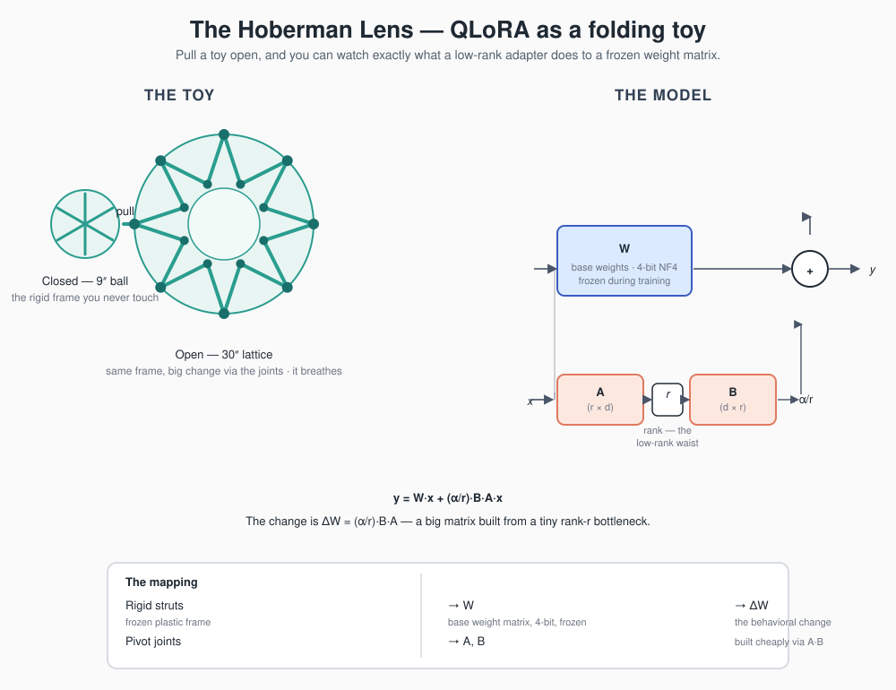

# 🌐 The Hoberman Lens

**Understanding LLM fine-tuning through a 1990s folding toy.**

A Hoberman Sphere — Chuck Hoberman's iconic geometric folding ball — opens and
closes with a single motion: a compact 9-inch sphere blooms into a 30-inch
lattice, and every point on its surface traces a clean, mechanical path. That
single gesture encodes, better than most textbook analogies do, the actual
*geometry* of what happens when you fine-tune a model with **QLoRA**.

This repo is the Hoberman Lens: a way of *seeing* what Low-Rank Adaptation does
to a frozen model — not by sticking sticky notes on a brain, but by installing a
tiny, efficient mechanical system that flexes existing knowledge into new
dimensions.



---

## Why the usual analogies fail

Ask any ML engineer to explain QLoRA (Quantized Low-Rank Adaptation) and you'll
get one of two answers:

1. *"It's like putting sticky notes in the margins of a giant textbook."*
2. *"It's like a chef adding a pinch of spice to a pre-made recipe."*

They're intuitive — but they hide the important part. Neither one lets you *see*
the geometry, the structural scaling, or the matrix arithmetic that actually
happens inside a transformer layer. To understand how QLoRA changes a model's
behavior **without changing its parameters**, you don't need a textbook.

You need a Hoberman Sphere.

---

## The metaphor, piece by piece

### 🧱 1. The rigid struts → the frozen 4-bit base model

The colorful plastic rods that make up the sphere's framework are your
pre-trained base model (Llama, Mistral, …).

- **In the toy:** the rods are rigid and pre-molded. You never cut them, melt
  them down, or change their length. You just open and close the structure.
- **In QLoRA:** these are the quantized base weights, locked into a read-only
  **4-bit (NF4)** format. They're strictly *frozen* — they provide the heavy
  structural framework and general language competence, but they never change
  during training.

### 📍 2. The pivot joints → the 16-bit LoRA adapters

What makes a Hoberman Sphere special isn't the static rods — it's the tiny,
strategic **pivot joints** where the rods interlock. Shift those minuscule pins
and you change the geometry of the *entire* sphere.

- **In the toy:** the joints are a tiny fraction of the sphere's total mass, yet
  they dictate its entire range of motion.
- **In QLoRA:** the joints are your **Low-Rank Adapters** — the skinny matrices
  `A` and `B`. Instead of touching billions of base parameters, QLoRA attaches
  these ultra-thin, unquantized **16-bit** matrices to the sides of network
  layers. Training a model means *only* tightening or loosening these joints.

### 📈 3. Mechanical expansion → the change matrix (ΔW)

Pull a Hoberman Sphere open and it expands from a 9-inch ball to a 30-inch
lattice. The structure's identity hasn't changed — but its dimensional footprint
has scaled dramatically.

- **In the toy:** the volume difference between closed and open is a structural
  transformation earned through low-rank mechanical advantage.
- **In QLoRA:** that expansion is exactly what mathematicians call **ΔW** (the
  weight delta). Instead of computing a massive, expensive change matrix the size
  of the base model, QLoRA uses the low-rank joints (`A × B`) to project and
  scale the behavioral change across the whole layer.

### 🔄 4. Infinite modularity → swap behavior on one frame

Keep a single heavy Hoberman Sphere on your desk, but carry a box of
interchangeable joint pins. Pop in **"rigid"** pins and it behaves like a solid
cage. Swap in **"elastic"** pins and it becomes a bouncy ball.

That's the superpower of parameter-efficient fine-tuning:

- **The base model stays loaded** — one giant 4-bit model parked permanently in
  GPU memory.
- **Micro-adapters hot-swap on the fly** — because training only touched the
  joints, your fine-tuned file is a few megabytes. Instantly swap a *coding*
  adapter, a *legal* adapter, or a *customer-service* adapter on the **same**
  underlying frame.

---

## The cheat sheet

| Hoberman Sphere | QLoRA equivalent | What it does during training |
| --- | --- | --- |
| Rigid plastic struts | Base weight matrix `W` | **Frozen** — compressed to 4-bit to save VRAM |
| Interlocking pivot pins | Adapter matrices `A` & `B` | **Active** — tuned at 16-bit precision to learn new tasks |
| Volumetric expansion | Weight delta `ΔW` | The resulting change in behavior and output |

---

## By the numbers — a worked example

The metaphor is a picture; the math is the thing. Here is a concrete case so the
numbers match the toy.

Take one attention weight matrix in a Llama-sized model:

```
W ∈ ℝ^(4096 × 4096)      # the "rigid strut" — one layer's weight
```

**Full fine-tuning** touches all of it:

```
4096 × 4096 = 16,777,216 trainable parameters
```

**QLoRA with rank r = 8** instead freezes `W` and trains two skinny matrices:

```
A ∈ ℝ^(8 × 4096)   B ∈ ℝ^(4096 × 8)   # the "pivot joints"
8×4096 + 4096×8 = 65,536 parameters
```

That is **0.39%** of the full matrix — the joints are a sliver of the frame.

And on memory, the 4-bit quantization of the struts is what lets one GPU carry
the whole sphere:

```
7B params @ 16-bit (bf16) → ~14 GB
7B params @  4-bit (NF4)  → ~3.5 GB    ≈ 4× smaller
```

The forward pass ties it together:

```
y = W·x + (α/r)·B·A·x
        └──── ΔW ────┘
```

`W·x` runs through the frozen 4-bit frame (dequantized on the fly for the
computation). `B·A` is the low-rank detour — a tiny matrix built from the rank-8
"waist" — and it is the *only* thing that gets updated. Swap `A` and `B`, and you
swap behavior on the same loaded model.

---

## Why this metaphor matters

The AI community keeps struggling to teach the difference between **feeding text
to a model** (RAG — retrieval-augmented generation) and **structurally changing
its weights** (fine-tuning). They look similar from the outside; they are
opposites under the hood.

The Hoberman Sphere resolves the confusion at a glance: QLoRA doesn't stick
notes onto a static brain. It installs a lightweight mechanical system that
gracefully **flexes** the model's existing structural knowledge into entirely new
dimensions — and does so cheaply enough that you can swap behaviors on a single
loaded frame.

> **RAG** = handing the sphere a new book to read.
> **Fine-tuning (QLoRA)** = changing the sphere so it *is* different.

---

## Where the metaphor breaks

A good metaphor earns its keep by saying something true — and by knowing where
it stops being true. This one has two fault lines. Flagging them keeps the
picture honest instead of misleading.

**1. The joints aren't *inside* the weights.** In the toy the pivot joints are
woven into the sphere's structure. In a transformer the adapter is *additive and
parallel* — `W' = W + (α/r)·B·A` runs as a side-channel *alongside* the frozen
`W`, not a hinge embedded in the matrix. The sphere captures "a tiny part
controls the whole shape"; it does not capture "the path is parallel, not
structural". The diagram marks this: `B·A` branches off next to `W`, it isn't
drawn inside it.

**2. The struts aren't frozen during computation.** "Frozen 4-bit" is true for
*training* — the gradients never reach `W`. But during the forward and backward
passes the 4-bit weights are **dequantized on the fly** to 16-bit so the math can
run. So the struts are frozen in *storage*, but live in *computation*. The toy's
rigid rods are frozen all the time; QLoRA's are only frozen on disk.

A metaphor that admits its own limits teaches more than one that overclaims.

---

## Repo layout

```
hoberman-lens/
├── README.md   ← the full metaphor, the worked example, and where it breaks
└── diagram.svg ← the toy ↔ weight-matrix mapping (renders on GitHub)
```

## The one-line pitch

*QLoRA is a Hoberman sphere for weights: rigid 4-bit struts you never touch,
16-bit pivot joints you tune, and a low-rank expansion that turns a tiny
adjustment into a whole new behavior.*
